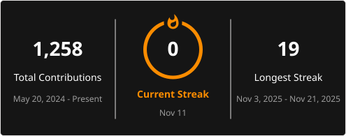

# 👋 Hi, I'm Vilizar Denichin

### Front-End Developer | React · TypeScript · Next.js · Testing

I build web applications with React, TypeScript, and Next.js, with a focus on responsive interfaces, API integration, accessibility, and automated testing. My projects include a bilingual business website, developer practice tools, and apps for planning workouts and discovering movies.

I'm also extending my backend skills with Node.js, Express, and Turso, and collaborating with a backend developer on a finance dashboard.

## 💻 Tech Stack

- **Frontend:** React · TypeScript · JavaScript · Next.js · HTML · CSS
- **Styling and motion:** Tailwind CSS · Sass/SCSS · Framer Motion
- **Testing:** Vitest · Jest · React Testing Library · Playwright
- **Backend work:** Node.js · Express · Turso/libSQL · REST APIs
- **Tools and deployment:** Git · GitHub Actions · Vite · Netlify · Vercel · Render

## 🚀 Featured Projects

### [Euphoria Wellness Studio](https://github.com/denichinv/euphoria-wellness-studio-bg)

🌐 [Live site](https://euphoria-wellness.com/)

A bilingual website for a boutique wellness studio offering Pilates Reformer and XBody EMS training.

- Bulgarian and English content with a shared translation system.
- Responsive service, gallery, contact, and footer sections.
- Image and video gallery with previous/next navigation.
- Netlify contact form with explicit service selection, submission feedback, and error handling.
- Component tests with Vitest and React Testing Library.

**Tech:** React · TypeScript · Tailwind CSS · Vite · Vitest · Netlify

### [Workout Routine Builder](https://github.com/denichinv/workout-routine-builder)

🌐 [Live app](https://workoutroutinebuilder.netlify.app/)

A weekly training planner with an exercise library backed by a Node.js API and Turso database.

- Seven-day planning with editable sets and reps.
- Weekly plans saved in LocalStorage.
- Express API for listing, adding, deleting, and importing exercises.
- Exercise-library storage migrated from SQLite to Turso, with validated inputs and parameterized queries.
- Netlify frontend configured to proxy API requests to Render.
- Jest and React Testing Library tests, with a GitHub Actions test workflow.

**Tech:** React · JavaScript · Tailwind CSS · Node.js · Express · Turso/libSQL · Jest · Netlify · Render

### [DevQuiz](https://github.com/denichinv/quiz-app)

🌐 [Live app](https://dev-quiz-v.netlify.app/)

A developer quiz app built around choosing a topic, practicing, and reviewing mistakes.

- Configurable categories, difficulty, and question count, with scoring and a progress bar.
- Immediate answer feedback and a question-by-question results review.
- Retry missed questions without fetching a new quiz, or play again with the original settings.
- Server-side QuizAPI proxy with input validation and response checks.
- Request timeouts, cancellation, clear errors, and retry controls.
- Keyboard focus management, responsive layouts, and reduced-motion support.
- Unit, component, integration, server-function, and Playwright browser tests, with GitHub Actions checks.

**Tech:** React · TypeScript · SCSS · Vite · Netlify Functions · Vitest · Playwright · GitHub Actions

### [CineVault](https://github.com/denichinv/CineVault)

🌐 [Live app](https://cinevaultmoviesapp.netlify.app/)

A movie discovery app using TMDB, with live title search and tools for narrowing down what to watch.

- Debounced search with keyboard-accessible movie suggestions.
- Category browsing, minimum-rating filters, and sorting options.
- Protection against outdated requests replacing the current results.
- Responsive movie cards with poster fallbacks.
- Loading placeholders and distinct empty-result messages.
- Vitest component tests and Playwright browser tests.

**Tech:** React · JavaScript · CSS · Headless UI · TMDB API · Vite · Vitest · Playwright

### [Portfolio Website](https://github.com/denichinv/vilizar-portfolio)

🌐 [Live site](https://vilizar.dev/)

My portfolio, built with Next.js 16 App Router, featuring project case studies and implementation details.

- Dedicated case-study pages covering project challenges, architecture, features, and testing.
- Page-specific canonical URLs and social-sharing metadata.
- Optimized project image sizing and semantic project lists.
- Responsive layouts and Framer Motion animations.

**Tech:** Next.js · React · TypeScript · Tailwind CSS · Framer Motion · Vercel

## 🤝 Collaboration Project

### [AI Finance App](https://github.com/denichinv/ai-finance)

A finance dashboard developed in collaboration with a backend developer. My focus is the React and TypeScript frontend and its integration with the ASP.NET Core API.

- Authenticated API requests and dashboard loading, empty, and error states.
- Transaction entry with amount, category, and date validation.
- Form values preserved when a submission fails.
- Spending charts and insights that distinguish expenses from income.
- Negative-balance feedback.
- Feature branches and pull requests for incremental changes.

**Frontend:** React · TypeScript · Tailwind CSS · Recharts · Axios · Framer Motion

## 📊 GitHub Stats

## 🌱 Open to Collaborate On

- React, TypeScript, and Next.js applications.
- Frontend testing and API integration.
- Projects that improve usability and accessibility.

## 🌐 Connect With Me

- [Portfolio](https://vilizar.dev/)
- [LinkedIn](https://www.linkedin.com/in/vilizar-denichin/)
- Email: denichinv@gmail.com

📍 Dunstable, Bedfordshire, UK  
💼 Open to Front-End Developer roles — remote, hybrid, or on-site.
